# Universal Autonomous Application: Comprehensive Architecture & Implementation Plan

**Target Repository**: `/Users/nikunjgupta/Downloads/PROJECTS/Memory_Setup`  
**Current Milestone**: Architecture Definition, Technical Specifications & Planning  
**Execution Mode**: Planning & Alignment Only (No code implementation until plan approval)  

---

## 1. Goal Description

Transform the battle-tested, 5-stage media intelligence pipeline (which successfully standardized, indexed, clustered, and mapped 33,771 personal files spanning 2007–2026 in `/Users/nikunjgupta/Downloads/images`) into a **universal, zero-configuration standalone desktop application with a modern Graphical User Interface (GUI)**.

### The Universal Contract
Any non-technical user on **macOS or Windows** can:
1. Open the application.
2. Complete a seamless **Interactive First-Time Setup Wizard** (detects/installs Ollama, downloads `moondream:latest`, and caches ONNX models).
3. Select or drag-and-drop a **single parent folder** containing an arbitrary collection of photos/videos in any chaotic nested directory structure (e.g. nested phone dumps, SD card backups, WhatsApp folders).
4. Choose their preferred processing mode via a clear UI toggle:
   * **In-Place Reorganization (Fast / Zero Extra Space)**: Uses atomic filesystem renames on the same disk.
   * **Strict Safe Copy (Preserve Originals)**: Preserves original files untouched and copies media into the new structure (with automated disk-space pre-flight verification).
5. Select their AI compute mode:
   * **Whisper Mode**: Single worker, bounded 2.2 GB RAM ceiling (`LLAMA_ARG_CACHE_RAM=0`), silent fans.
   * **Turbo Mode**: Continuous throughput with periodic 200-item runner recycling for unattended/overnight runs.
6. Click **"Organize & Build Museum"** and watch real-time visual progress cards across all 5 stages.
7. Arrive at a standardized, clean root folder containing **strictly two directories**:
   * **`content/`**: Pure organized user media (`images/YYYY/`, `videos/YYYY/`, and non-media `documents/`).
   * **`viewer/`**: The complete, self-contained interactive museum runtime (`viewer.html`, `catalog.sqlite` with FTS5 search, `catalog_data.js`, face avatars, proxy cache, and zero-config local streaming launchers).

```mermaid
flowchart TD
    subgraph INPUT["1. ARBITRARY USER INPUT"]
        DIR["Raw Parent Folder<br/>(Chaotic subfolders, SD cards, phone backups, mixed formats)"]
    end

    subgraph ENGINE["2. AUTONOMOUS MEDIA INTELLIGENCE ENGINE (Memory_Setup)"]
        direction TB
        SETUP["Stage 0: Pre-Flight & Setup Wizard<br/>• Ollama connectivity & model puller<br/>• ONNX biometrics check & auto-download<br/>• Hardware accelerator selection (CoreML / DirectML / CUDA)"]

        INGEST["Stage 1: Universal Ingestion & Deduplication<br/>• Magic-bytes MIME sniffing (header validation)<br/>• Cross-platform HEIC decoder (pillow-heif)<br/>• SHA-256 hash deduplication<br/>• Apple Live Photo pairing & AAE/XMP linkage"]
        
        NORM["Stage 2: Normalization & Storage Routing<br/>• User Choice: In-Place Atomic Re-Parenting OR Safe Copy<br/>• Non-media document segregation (PDF, DOCX, TXT to content/documents/)<br/>• Standardized directory tree: content/images/YYYY/ and content/videos/YYYY/"]
        
        META["Stage 3: Metadata Extraction & Offline Geocoding<br/>• Fast EXIF / QuickTime timestamp extraction<br/>• Bundled spatial KD-Tree (15,000 world cities, 0 API keys, 0.05ms/photo)"]
        
        BIO["Stage 4A: Biometric ArcFace Engine<br/>• SCRFD-10GF face detection with 5-point landmark alignment<br/>• ArcFace ResNet-50 512-d L2-normalized embeddings<br/>• Vectorized Leader Centroid Clustering (thresh = 0.48)<br/>• Top family member ranking & avatar generator"]
        
        DOC["Stage 4B: Multi-Layer High-Precision Document Classifier<br/>• Strict Family Face Disqualification (has_faces == True -> NOT doc)<br/>• Narrative Subject Disqualification (person/event starters rejected)<br/>• High-precision study phrases (math problem, notebook page, worksheet)"]
        
        VLM["Stage 4C: Memory-Bounded Local Vision AI (Moondream)<br/>• Strict Single-Worker Constraint (1 image at a time)<br/>• LLAMA_ARG_CACHE_RAM=0 (eliminates 8 GiB prompt cache bloat)<br/>• Periodic 200-item keep_alive:0 runner recycling (strictly <2.5 GB RAM)"]
        
        MUSEUM["Stage 5: Offline Museum Synthesizer<br/>• SQLite FTS5 full-text search indexing with relative portable paths<br/>• Anti-clobber architecture: immutable viewer.html + dynamic catalog_data.js<br/>• Cross-platform launcher suite (server.py, start_viewer.command, start_viewer.bat)"]

        SETUP --> INGEST --> NORM --> META --> BIO --> DOC --> VLM --> MUSEUM
    end

    subgraph OUTPUT["3. STRICT TWO-FOLDER CONTRACT"]
        direction TB
        C["content/<br/>├── images/YYYY/<br/>├── videos/YYYY/<br/>└── documents/"]
        V["viewer/<br/>├── viewer.html (Immutable Application Bundle)<br/>├── catalog_data.js (Dynamic Data Payload)<br/>├── catalog.sqlite (FTS5 search, relative paths)<br/>├── avatars/<br/>├── .processing_cache/<br/>├── server.py & start_viewer.command / .bat<br/>└── content -> ../content (symlink)"]
    end

    DIR --> ENGINE --> OUTPUT
```



---

## 2. Root Cause Investigations & Architectural Resolutions

### 1. The 10+ GB Ollama Memory Bloat: Root Cause & Resolution
* **The Empirical Observation**: In Activity Monitor, Ollama's underlying runner process (`llama-server`) expanded to **10+ GB of RAM by itself**, pushing total machine RAM to 14 GB and triggering yellow/orange memory pressure.
* **The Underlying Technical Root Cause**:
  1. **The 8 GiB Default Prompt Cache (`--cache-ram`)**:
     * In `llama.cpp` / `llama-server`, the default configuration allocates up to **8192 MiB (8 GiB) of host RAM** for an internal prompt/prefix KV cache.
     * In a conversational multi-turn chat, caching prefixes helps. But in a **batch photo pipeline**, every single photo is a completely new, independent image.
     * Over 1,500+ sequential image requests, `llama-server` continuously cached each photo's visual token context into host RAM until it reached its hard limit: **8.0 GB**.
  2. **Model Base Weights + 8 GB Cache**:
     * Base quantized Moondream model in Metal: **2.16 GB**.
     * Unbounded prompt cache: **8.00 GB**.
     * **Total process footprint: 2.16 GB + 8.00 GB = ~10.16 GB**.
  3. **Linear Host Memory Creep (Ollama Issue #18106)**:
     * In long-running sequential loops, intermediate tensor allocations in `llama-server` accumulate at ~5–10 MiB per request if the runner process is never recycled.
* **The Architectural Resolution for the Standalone App**:
  * **Disable the Prompt Cache**: The app configures `LLAMA_ARG_CACHE_RAM=0` (or `cache_prompt: false`), completely eliminating the 8 GiB cache allocation.
  * **Periodic Model Runner Recycling (Every 200 Images)**:
    Every 200 images (aligned with SQLite transaction commits), the worker calls:
    ```python
    requests.post('http://127.0.0.1:11434/api/generate', json={'model': 'moondream:latest', 'keep_alive': 0})
    ```
    This completely terminates `llama-server`, flushes all heap allocations and uncollected Metal buffers, and restarts it fresh on the next image. Memory footprint is reset back to **2.16 GB**.
  * **Explicit Context Clamping**: Request payloads pass `"options": {"num_ctx": 1024, "num_predict": 128}`, preventing oversized token buffers.
  * **Process Watchdog Guard**: The worker monitors `llama-server` RSS. If memory exceeds 3.0 GB, it triggers an instant flush/restart.

---

### 2. High-Precision Document & Homework Classification (Bug Resolution)
* **The Problem**: 22 family photos (including birthday cakes with dolls, couples in front of churches, and children on benches) were erroneously flagged as homework and removed from the main gallery.
* **The Root Cause**: Naive substring keyword matching:
  - Any t-shirt with a brand name, birthday cake with text, or shopping bag was described by Moondream as *"with the words ... written on it"*, which triggered the over-broad keyword `'written on it'`.
  - Any tourist holding a brochure or map was described as *"holding a piece of paper"*, triggering `'piece of paper'`.
* **The Architectural Resolution**:
  * **Strict Face Disqualification**: Any photo with verified family faces (`has_faces == True`) is **strictly disqualified** from being categorized as homework/documents.
  * **Primary Narrative Subject Disqualification**: Photos starting with human subjects (`"in the image, a young boy/girl/man/woman/baby/couple/group..."`) or family event settings (`birthday cake`, `church`, `mountain range`, `wedding`, `beach`) are immediately rejected.
  * **High-Precision Multi-Term Study Patterns**: A photo is only classified as homework if it matches explicit structural document indicators:
    * `page from a notebook`, `notebook open to a page`, `open notebook`, `page of a notebook`
    * `math problem`, `mathematical equations`, `math equations`, `handwritten notes`, `worksheet`, `textbook page`
    * Standalone digital screenshots (`phone screen displaying`, `screenshot of`) without a person holding the device.
  * **Outcome**: False positives dropped from **22 to 0** (100% precision, 0 family photos misclassified).

---

### 3. Browser Security Policy Resolution (`file://` vs. Local Streaming Server)
* **The Problem**: When a user double-clicks `viewer/viewer.html` directly from disk (`file:///`), Chromium-based browsers (Chrome, Edge, Brave) enforce strict **directory traversal sandboxing**. Sibling directory references like `../content/images/...` are blocked with: `Not allowed to load local resource`.
* **The Architectural Resolution**:
  * **In-App GUI Execution**: The desktop application operates via `pywebview` backed by an embedded FastAPI ASGI server over `http://localhost:<port>`. The server mounts the root directory, making `content/` and `viewer/` accessible with zero browser security blocks.
  * **Zero-Config Standalone Launcher Suite**: To allow users to open the museum outside the application at any time without terminal knowledge, Stage 5 generates:
    * `viewer/server.py`: A lightweight, zero-dependency Python HTTP server with automatic port-hunting (8080–8095) that opens the default browser automatically.
    * `viewer/start_viewer.command` (macOS double-clickable) and `viewer/start_viewer.bat` (Windows double-clickable).
    * A top-level launcher shortcut at the archive root (`start_viewer.command` / `.bat`) so users can double-click right from the main folder.
  * **JavaScript Multi-Stage Fallback (`handleImgError`)**: Inside `viewer.html`, an image loading error handler dynamically resolves `.processing_cache/` proxy JPEGs, toggles `../` prefixes, and falls back to original master files automatically.

---

### 4. Strict Separation of Application Code vs. Data Payloads (Anti-Clobber Contract)
* **The Problem**: In our initial Stage 5 script, a monolithic `generate_viewer_html()` function regenerated `viewer.html` from scratch on every run. When rerun, it clobbered custom additions, lost the `#peopleManagerModal`, and reverted to a hardcoded 120-image sample.
* **The Architectural Resolution**:
  * **Immutable Application Template**: `viewer.html` is an immutable, static application bundle packaged in `memory_setup/viewer/template/viewer.html`. It is written once during archive initialization.
  * **Dynamic Data Payloads**: Stage 5 strictly regenerates **data artifacts**:
    * `catalog_data.js`: High-speed browser payload (`ALL_PHOTOS`, `MAP_LOCATIONS`, `CORE_CLUSTERS`, `EXTENDED_CLUSTERS`).
    * `catalog.sqlite`: Rebuilds the `ai_search_fts` FTS5 virtual table.
    * `catalog.json`: Full master export.
  * **Idempotency Guarantee**: Subsequent pipeline runs (e.g. syncing newly generated AI descriptions) ONLY refresh data payloads and **never** overwrite or modify `viewer.html`.

---

### 5. Non-Blocking Live AI Description Sync
* **The Problem**: Full vision passes across 30k+ images take several hours. Users want to explore completed captions in the museum without waiting for the entire queue to finish or risking SQLite locks.
* **The Architectural Resolution**:
  * The vision worker commits in small micro-transactions (batches of 10) under SQLite WAL mode (`PRAGMA journal_mode=WAL;`).
  * The GUI dashboard features a **"Refresh Museum Data"** button (plus an optional auto-sync interval) that triggers an instantaneous (<0.3s) FTS5 index sync and `catalog_data.js` re-export.
  * Users can simply refresh their browser tab (`Cmd + R` / `F5`) while the background AI continues processing seamlessly.

---

## 3. Operational Rules & Resource Protocols

> [!IMPORTANT]
> **Memory & Threading Guardrails**:
> - VLM inference in `Memory_Setup` is **strictly single-worker** (`max_workers = 1`).
> - The prompt cache is disabled (`LLAMA_ARG_CACHE_RAM=0`) and models are recycled every 200 items, guaranteeing memory stays strictly under **2.5 GB** across tens of thousands of images.
> - During development and unit testing in `Memory_Setup`, tests MUST use lightweight synthetic fixtures with zero neural network loads.

---

## 4. Proposed Changes & Component Architecture

### Component 0: Interactive Setup & Dependency Guide (`memory_setup.setup`)

#### [NEW] `memory_setup/setup/checker.py`
- Tests Python version ($\ge 3.10$) and platform architecture.
- Detects optimal execution provider: `CoreMLExecutionProvider` (macOS), `CUDAExecutionProvider` / `DmlExecutionProvider` (Windows), or `CPUExecutionProvider`.
- Checks Ollama connectivity via `GET http://127.0.0.1:11434/api/tags`.
- Verifies biometric ONNX model weights and cached city database.

#### [NEW] `memory_setup/setup/installer.py`
- Guided Ollama installer links for macOS (`.dmg`) and Windows (`.exe`).
- Model puller via `POST http://127.0.0.1:11434/api/pull` streaming live download progress bytes.
- Automatic download of SCRFD and ArcFace ONNX weights to `~/.cache/memory_engine/models/` with SHA-256 verification.

---

### Component 1: Application Shell & Desktop GUI (`memory_setup.gui`)

#### [NEW] `memory_setup/gui/app.py`
- FastAPI ASGI backend with loopback CORS.
- Native OS window via `pywebview` (WKWebView on macOS, WebView2 on Windows).
- Exposes native folder picker: `pywebview.api.select_folder()`.
- Endpoints:
  - `GET /api/status`: System setup health, process RSS memory, and pipeline status.
  - `POST /api/pipeline/start`: Parameters (`folder_path`, `storage_mode`, `speed_mode`, `enable_vision`).
  - `POST /api/pipeline/sync`: Triggers fast on-the-fly museum data sync (<0.3s).
  - `POST /api/pipeline/pause`: Stops worker and triggers `keep_alive: 0` to immediately free VRAM.
  - `GET /api/pipeline/events`: SSE stream delivering real-time progress and logs.

#### [NEW] `memory_setup/gui/static/index.html` & `app.js`
- Modern responsive dashboard using Tailwind CSS and Alpine.js.
- Drag-and-drop folder selector.
- Segmented storage control: `[ In-Place Move ]` | `[ Safe Copy ]`.
- Segmented speed control: `[ Whisper (Low RAM / Cool) ]` | `[ Turbo (Continuous) ]`.
- Live 5-stage progress cards with throughput counters, memory monitor, and current image thumbnails.
- 1-click **"Open Offline Museum"** button upon completion.

---

### Component 2: Universal Ingestion & Normalizer (`memory_setup.ingestion`)

#### [NEW] `memory_setup/ingestion/sniffer.py`
- Magic-bytes header sniffer (first 32 bytes) identifying JPEG, PNG, HEIC, MOV, MP4, and documents regardless of extension.

#### [NEW] `memory_setup/ingestion/companions.py`
- Pairs Apple Live Photos via EXIF `ContentIdentifier` / `MediaGroupUUID` and secondary base stem matching ($\pm 2\text{s}$).
- Links `.AAE` and `.XMP` sidecars to master photos.

#### [NEW] `memory_setup/ingestion/router.py`
- Enforces strict two-folder contract:
  - `content/images/YYYY/`, `content/videos/YYYY/`, `content/documents/`.
  - `viewer/.processing_cache/` proxy generation using cross-platform `pillow-heif` (zero `sips` dependency).
  - Creates relative symlink `viewer/content -> ../content`.

---

### Component 3: Hardware-Adaptive Biometrics (`memory_setup.biometrics`)

#### [NEW] `memory_setup/biometrics/detector.py`
- SCRFD-10GF face detector with 5-point facial landmark alignment.
- Smart Hybrid reading: reads proxy JPEGs for HEIC and master files for JPG/PNG.

#### [NEW] `memory_setup/biometrics/embedder.py`
- ArcFace ResNet-50 producing 512-dimensional $L_2$-normalized metric unit vectors.

#### [NEW] `memory_setup/biometrics/cluster.py`
- Vectorized Leader Centroid Clustering with verified cosine similarity threshold $T = 0.48$.
- Bridges childhood vs. adulthood drift without false cross-family merges.
- Crops canonical eye-aligned avatar thumbnails into `viewer/avatars/cluster_X.jpg`.

---

### Component 4: Embedded Offline Geocoding (`memory_setup.geocoding`)

#### [NEW] `memory_setup/geocoding/offline_tree.py`
- Bundles `cities15000.sqlite` (15,000 world cities with population $\ge 15,000$).
- Spatial `scipy.spatial.KDTree` on 3D Cartesian coordinates.
- Resolves GPS $(lat, lon) \to (City, State, Country)$ in **0.05ms per photo** with zero API keys or network calls.

---

### Component 5: Document Classifier & Vision AI (`memory_setup.vision`)

#### [NEW] `memory_setup/vision/classifier.py`
- High-precision multi-layer document and homework classification:
  - Strict face disqualification (`has_faces == True` $\to$ False).
  - Narrative subject starter disqualification (`"in the image, a young boy/girl/couple..."` $\to$ False).
  - Event/setting disqualification (`birthday cake`, `church`, `mountain range` $\to$ False).
  - High-precision study phrase validation (`page from a notebook`, `math equations`, `worksheet`, `textbook page`).
  - Standalone app screenshot detection without human presence.

#### [NEW] `memory_setup/vision/ollama_client.py`
- Memory-bounded single-worker Ollama client querying `moondream:latest`.
- Batched commits every 10 images with live checkpointing and graceful interrupt support.
- Automatic runner recycling every 200 images via `keep_alive: 0` to flush heap memory and prevent 8 GiB cache bloat.
- Context bounded via `"options": {"num_ctx": 1024, "num_predict": 128}`.

---

### Component 6: Museum Synthesizer & Launcher Suite (`memory_setup.viewer`)

#### [NEW] `memory_setup/viewer/builder.py`
- Deploys immutable `viewer.html` template once.
- Initializes SQLite with WAL mode, relative POSIX paths, and composite indexes.
- Rebuilds `ai_search_fts` FTS5 virtual table.
- Exports high-speed `catalog_data.js` browser payload.
- Deploys launcher suite:
  - `viewer/server.py`: Lightweight Python streaming server with automatic port-hunting.
  - `viewer/start_viewer.command` & `start_viewer.bat`.
  - Archive root launcher shortcut: `start_viewer.command` / `.bat`.

#### [NEW] `memory_setup/viewer/template/viewer.html`
- Complete single-page museum application:
  - 32k+ photo timeline gallery with 60fps virtual scrolling.
  - Esri ArcGIS World Map (35+ cities, 4 layer styles, city photo filtering).
  - People & Faces tab with all 30 top clusters (9 core family + 21 recurring).
  - Interactive `⚙️ Manage & Merge People` modal with 1-click cluster merger, custom naming, and migration script exporter (`commit_merges.py`).
  - Homework Cleanup tab with `Export cleanup_homework.sh`.
  - Multi-stage image error fallback (`handleImgError`) ensuring images load under any server or file configuration.

---

## 5. File Structure in `Memory_Setup`

```
/Users/nikunjgupta/Downloads/PROJECTS/Memory_Setup/
├── pyproject.toml
├── README.md
├── ARCHITECTURE.md
├── memory_setup/
│   ├── __init__.py
│   ├── cli.py                    # Standalone CLI entrypoint
│   ├── config.py                 # Pydantic global settings
│   ├── setup/                    # Component 0: Setup & Dependency Guide
│   │   ├── __init__.py
│   │   ├── checker.py            # Health diagnostics (Ollama, models, GPU)
│   │   └── installer.py          # Auto-puller for models, Ollama guidance
│   ├── gui/                      # Component 1: Desktop GUI & Webview Shell
│   │   ├── __init__.py
│   │   ├── app.py                # FastAPI ASGI server + pywebview launcher
│   │   └── static/
│   │       ├── index.html        # Modern Tailwind dashboard
│   │       ├── app.js            # Reactive Alpine.js frontend logic
│   │       └── style.css
│   ├── ingestion/                # Component 2: Format Sniffer & Router
│   │   ├── __init__.py
│   │   ├── sniffer.py            # Magic-bytes MIME identification
│   │   ├── companions.py         # Live Photos & sidecar matching
│   │   └── router.py             # In-Place / Safe-Copy normalizer
│   ├── geocoding/                # Component 3: Offline Spatial Geocoder
│   │   ├── __init__.py
│   │   ├── offline_tree.py       # Spatial KD-Tree over 15k cities
│   │   └── assets/
│   │       └── cities15000.sqlite
│   ├── biometrics/               # Component 4: Biometric Face Engine
│   │   ├── __init__.py
│   │   ├── detector.py           # SCRFD-10GF (5-point alignment)
│   │   ├── embedder.py           # ArcFace ResNet-50 512-d
│   │   └── cluster.py            # Vectorized Leader Centroid (thresh=0.48)
│   ├── vision/                   # Component 5: Document Filter & Ollama VLM
│   │   ├── __init__.py
│   │   ├── classifier.py         # High-precision multi-layer document classifier
│   │   └── ollama_client.py      # Memory-bounded single-worker Moondream generator
│   └── viewer/                   # Component 6: Museum Synthesizer & Bundler
│       ├── __init__.py
│       ├── builder.py            # FTS5 indexer, data payload exporter
│       └── template/
│           ├── viewer.html       # Immutable Museum HTML with Map & Person Merger
│           ├── server.py         # Lightweight local streaming server
│           ├── start_viewer.command # macOS 1-click launcher
│           └── start_viewer.bat  # Windows 1-click launcher
└── tests/                        # Lightweight unit tests (RAM-safe)
    ├── test_checker.py
    ├── test_sniffer.py
    ├── test_companions.py
    ├── test_geocoder.py
    ├── test_clustering.py
    ├── test_document_classifier.py
    ├── test_memory_bounded_client.py
    └── test_museum_builder.py
```

---

## 6. Implementation Phases & Milestones

| Phase | Target Module | Key Deliverables | Verification Milestone |
| :--- | :--- | :--- | :--- |
| **Phase 1** | Project Scaffolding & Setup Guide | `pyproject.toml`, directory tree, Pydantic settings, health checker, Ollama model puller. | Installs cleanly via `uv pip install -e .`; diagnostics report system health. |
| **Phase 2** | Universal Ingestion & Normalizer | Magic-bytes sniffer, companion Live Photo matcher, sidecar linker, two-folder router (In-Place & Safe Copy) with `pillow-heif`. | Ingests a synthetic test corpus of mixed, corrupted, and nested files into `content/` and `viewer/`. |
| **Phase 3** | Metadata & Offline Geocoding | Fast EXIF/QuickTime parser, embedded KD-tree spatial geocoder (15k cities). | Resolves 1,000 GPS coordinates in $<0.1\text{s}$ with zero network requests. |
| **Phase 4** | Biometrics & Vision AI Engine | InsightFace SCRFD + ArcFace 512-d pipeline, Leader Centroid clustering (thresh=0.48), high-precision document classifier, memory-bounded single-worker Ollama client. | Accurately clusters family members across age gaps; 0 family photos misclassified as homework; RAM strictly bounded $<2.5$ GB. |
| **Phase 5** | Museum Generator & Launcher Suite | Anti-clobber builder, FTS5 indexer, `catalog_data.js` exporter, `server.py`, `start_viewer.command` / `.bat`. | Museum opens in browser via launcher; map, search, and people tabs fully interactive. |
| **Phase 6** | Desktop GUI & Packaging | Native desktop GUI window (`pywebview`), folder picker, live progress dashboard, speed mode selector, PyInstaller binary. | Standalone executable launches on macOS and Windows, processes folder end-to-end. |

---

## 7. Verification Plan

### Automated Tests (Lightweight & RAM-Safe)
All unit tests run on synthetic in-memory fixtures without loading large neural models:
```bash
cd /Users/nikunjgupta/Downloads/PROJECTS/Memory_Setup
pytest tests/ -v
```
- `test_checker.py`: Verifies Ollama connectivity mock and missing-tool diagnostics.
- `test_sniffer.py`: Verifies magic-byte detection across corrupt file headers.
- `test_companions.py`: Validates Live Photo pairing logic using mocked metadata.
- `test_geocoder.py`: Verifies offline coordinate resolution (e.g. Paris, Tokyo, New York).
- `test_clustering.py`: Verifies leader clustering threshold (0.48) on synthetic 512-d unit vectors.
- `test_document_classifier.py`: Validates document precision against known adversarial cases (birthday cakes, t-shirts with text, people on benches, versus real math worksheets).
- `test_memory_bounded_client.py`: Verifies that `LLAMA_ARG_CACHE_RAM=0` and 200-item model recycling parameters are passed to Ollama requests.
- `test_museum_builder.py`: Verifies anti-clobber guarantee (ensures `viewer.html` is never overwritten on data re-exports).

### Manual Verification
1. **Launch Setup Guide**:
   Run `memory-setup --setup` or launch GUI. Verify diagnostics card correctly identifies system hardware, Ollama status, and models.
2. **Synthetic Folder Test**:
   Create a small mock folder (`test_raw/` with 5 photos, 1 Live Photo, 1 PDF document, and 1 corrupt file).
   Run `memory-setup test_raw/ --inplace`.
   Verify that `test_raw/` cleanly resolves into:
   - `test_raw/content/images/YYYY/`
   - `test_raw/content/documents/`
   - `test_raw/viewer/viewer.html`
   - `test_raw/start_viewer.command`
3. **Open Museum**:
   Double click `start_viewer.command`. Verify that photos render, map markers appear, and search functions properly over local HTTP.
